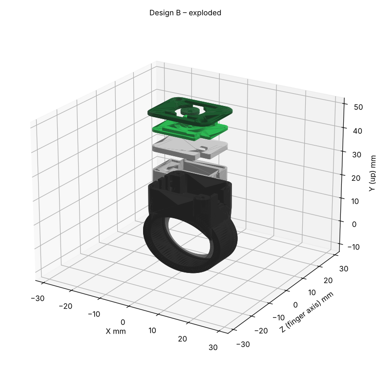

# Project GREEN LANTERN: DIY contactless payment power ring (UK)

A 3D-printed, illuminated Green Lantern ring that makes **genuine contactless payments at ordinary UK
terminals**, with no phone at checkout.

> **Status: Phase 1 (feasibility) complete on paper. v0.1 CAD and circuit designed. Nothing has been
> purchased, printed, built or tested in the real world yet.** No part of this repository claims a
> working payment ring.

## The answer so far (Tasks 1–4)

1. **Repurposing a £5–£15 prepaid or debit card (Approach A): NO-GO as the primary route.** The card
   costs ~£0 (Monzo gives two free replacements a year), but there are serious problems:
   * many cards are coil-on-module, with no antenna pads to solder to;
   * the issuer's terms forbid tampering;
   * normally only one physical card is live at a time;
   * SCA/PIN lock-outs (now issuer-dependent after the FCA change of 19 Mar 2026);
   * the ring dies at expiry or reissue.

   The PDF you sent shows it *can* work (with a range of 0–5 cm) for wire-bonded cards. It remains an
   optional experiment. → [`research/prepaid_card_feasibility.md`](research/prepaid_card_feasibility.md)
2. **IDEMIA (Approach B): the right hardware, the wrong channel.** The Flybuy Mini FOB (SIM-size, about
   25 × 15 mm, antenna integrated, Visa and Mastercard certified) is sold to **issuers**. Samples carry
   test keys that live terminals reject. Worth one polite personal enquiry (kept private, not in this repo).
3. **Your Cash App Wand idea is the right *pattern*:** a small passive tag provisioned by the issuer and
   linked to an existing card. Cash App isn't available in the UK, so the UK equivalent is a **Curve-linked
   wearable activated through DIGISEQ Manage-Mii or Fidesmo Pay.**
4. **Recommendation:**
   * **Primary (D):** buy a cheap, **Curve-compatible payment ring**, activate it unmodified, and print
     the Green Lantern ring as a **shell around it**. It slides out intact for service or replacement.
   * **Fallback (E):** an intact Curve-linked flat tag under the emblem.

   → [`research/payment_hardware.md`](research/payment_hardware.md) (decision matrix: D 3.75,
   E 3.50, C 3.50, B blocked, A 2.80)

**Biggest open risk:** Lloyds Banking Group is acquiring Curve (deal expected to complete H1 2026). I
found no statement on whether Manage-Mii and Fidesmo wearables continue afterwards. Check this in the
apps **before buying anything** (task P1-03).

## Costs (estimates, unverified prices; see `shopping/uk_bom.csv`, `tools/bom_totals.py`)

| Stage | Cost | Notes |
|---|---|---|
| Minimum NFC proof of concept (Phase 2) | **≈ £15** | NTAG cards, magnet wire and acetone; iPhone for reading |
| Basic functioning **payment** prototype | **≈ £25–£75** | The Curve-compatible ring (£25 sale listing seen; list price £75) plus a free Curve account |
| Finished rechargeable illuminated ring | **≈ £76 (ring at £25) to £126 (ring at £75)** | Assumes you already own filament, a soldering iron and a multimeter (otherwise +£50–£90) |

**The £30–£50 target is achievable only if the £25 ring price is real**, and then only for the
payment-plus-shell prototype. The finished, lit ring is realistically £75–£125. That is still well
below the £100–£240 for premium payment rings, and it includes the lighting, which they don't have.

## Repository map

| Path | What |
|---|---|
| `research/` | Payment feasibility (A–E), decision matrix, antenna engineering, suppliers, sources |
| `cad/` | Parametric OpenSCAD: ring body, retainer, bezel, lens, centre disc, diffuser, cartridge, insert holder, cradle, sizer, jigs ([README](cad/README.md)) |
| `stl/` | Generated STLs: `design_A/B/C/`, `shared/` |
| `electronics/` | Architecture, component choices, calculations (Python), schematics (SVG), wiring plan |
| `firmware/` | Why there is none in v0.1, and the optional upgrade path |
| `shopping/uk_bom.csv` | UK shopping list, split into proof-of-concept / payment / complete / optional / tools |
| `tests/` | Test plan with pass/fail criteria, results log, CAD verification report |
| `guides/` | Printing, assembly, charging, troubleshooting, and lessons (NFC, EMV, LEDs, Li-ion, CAD, multimeter) |
| `images/` | Renders (illustrative, from the verified meshes) and schematics |
| `tools/` | `build_and_verify.py` (STL export + checks), `bom_totals.py` |

Reproduce everything: `python3 tools/build_and_verify.py`,
`python3 electronics/calculations/*.py`, `python3 electronics/schematic/draw_schematic.py`,
`python3 research/decision_matrix.py`, `python3 tools/bom_totals.py`.

## Roadmap and progress

| Phase | Goal | Status | Gate to pass |
|---|---|---|---|
| 1. Feasibility | Compare A–E, provisioning, suppliers, budget | **Done (desk)** | GO/NO-GO table in `payment_hardware.md` §8 |
| 2. Basic NFC | NTAG experiments, coil winding, range measurements | Not started | ANT-01…05 logged |
| 3. Payment capability | Buy and activate the Curve-compatible ring; pay with it unmodified | Not started | **PAY-01: 5/5 authorised transactions** |
| 4. Ring prototype | Sizer → measure core → fit-print shell | CAD v0.1 done | MECH-01/02, PAY-02 |
| 5. LED electronics | Build the cartridge and cradle; test charging | Designed | LED-01…07, CHG-01…05 |
| 6. Integration | Shell + core + electronics, payment with lights on | — | PAY-03…06, ANT-04 |
| 7. Final build | Finish, documentation, maintenance | — | INT-01…03, two weeks' wear |

## Next actions (in order)

1. **P1-03**: in the Curve app, confirm that wearables via Manage-Mii (or Fidesmo) can still be linked,
   and which ring models are supported. (£0, 15 min)
2. **MECH-01**: print `stl/shared/ring_sizer_set.stl` and find your UK size. Tell me your **printer
   model, nozzle size and materials**.
3. Send the IDEMIA, Universal Smart Cards and Manage-Mii enquiries (optional, parallel).
4. Buy the ring in your size, activate it, and run **PAY-01**. Measure its ID, OD and width, and send
   me the numbers. I'll regenerate the CAD (v0.2).
5. Phase 2 kit (≈ £15) if you want to learn antenna work along the way.

## Project tracker

**Confirmed facts (with sources in `research/`)**
* The Cash App Wand is an issuer-provisioned tag ($25, Visa); Cash App is not available to UK users.
* Curve plus DIGISEQ Manage-Mii has enabled UK wearable payments since 2023. Fidesmo supports the UK via Curve.
* IDEMIA, Infineon and Tappy payment modules are sold B2B to issuers and brands.
* FCA contactless-limit flexibility started 19 Mar 2026; the £100 single-tap limit is unchanged for now.
* Monzo: two free card replacements a year, then £5.
* The CAD meshes are watertight with zero interference (automated check, `tests/cad_verification.json`).

**Open engineering questions**
* Q1: Does Manage-Mii or Fidesmo wearable support survive the Lloyds–Curve deal?
* Q2: The real dimensions of the chosen payment ring (ID, OD, width).
* Q3: Does the ring's antenna tolerate the cell and LEDs in the head? (ANT-04, PAY-03/04)
* Q4: How does the issuer or Curve handle SCA/PIN prompts for wearables? (PAY-06)
* Q5: Real V_f of the green LEDs at 1–2 mA; MCP73831 termination at 66.5 kΩ.
* Q6: A tiny protected LiPo with a datasheet that fits 12 × 10 × 3 mm (and a Design A option).
* Q7: Your printer, nozzle and materials.

**Risks**
| Risk | Likelihood | Impact | Mitigation |
|---|---|---|---|
| Curve or Manage-Mii wearable support ends | Medium | High | Fidesmo route; bank-issued wearables; IDEMIA/USC enquiries |
| Ring antenna detuned by the cell | Medium | High | Ferrite; cell farther away; Design A/B/C trade-off; test before final print |
| Ring too tall or wide to wear daily | Medium | Medium | v0.2 height reduction; Design A |
| Cell or charging safety | Low | High | PCM cell, cradle charging, diode, 0.5 C, removable cartridge, tests CHG-0x |
| Price estimates wrong | Medium | Low | Verify before ordering |

**Decisions log**
| # | Decision | Why |
|---|---|---|
| D-01 | Primary payment architecture = an intact Curve-compatible payment ring as the core (D) | Highest weighted score; legitimate activation; no modification |
| D-02 | No card transplant as the primary route | Contractual, SCA, expiry and CoM risks |
| D-03 | Charger IC in the cradle; Schottky diode in the ring | Smaller ring; contacts are short-proof |
| D-04 | No microcontroller in v0.1 | No requirement for one; no idle drain |
| D-05 | Payment and lighting electrically isolated | Safety; certification integrity |
| D-06 | Pogo-pin cradle, no magnets | Magnets degrade NFC and ferrite |

**Components selected (v0.1):** Curve-compatible payment ring (model TBC, e.g. NEO Ceramic); LiPo
≥30 mAh with PCM; 3× Kingbright APTD1608LZGCK; 3× 680 Ω; BAT54; MSK-12C02-class slide switch; Ø1 mm
brass contacts; NFC ferrite sheet; Adafruit Micro-Lipo USB-C (#4410) with PROG = 66.5 kΩ; P75 pogo pins.

## Safety, legality and payment compliance (summary)

* **NFC communication** is just radio. **EMV certification** approves a device *type*.
  **Provisioning** puts *your* credential (or a token) into a certified secure element. **Issuer
  acceptance** is the issuer agreeing to that device. Approach D keeps all four intact.
* We never extract keys, clone or copy card data, relay or emulate cards, or bypass issuer
  authentication. A device made that way would be a counterfeit payment instrument, and illegal.
* Modifying your own card is not fraud, but it can breach your cardholder agreement. Ask first.
* The Li-ion cell is always protected and removable, charged only off the finger, in the cradle.
* The Green Lantern emblem is a DC trademark: this build is for personal use only.
